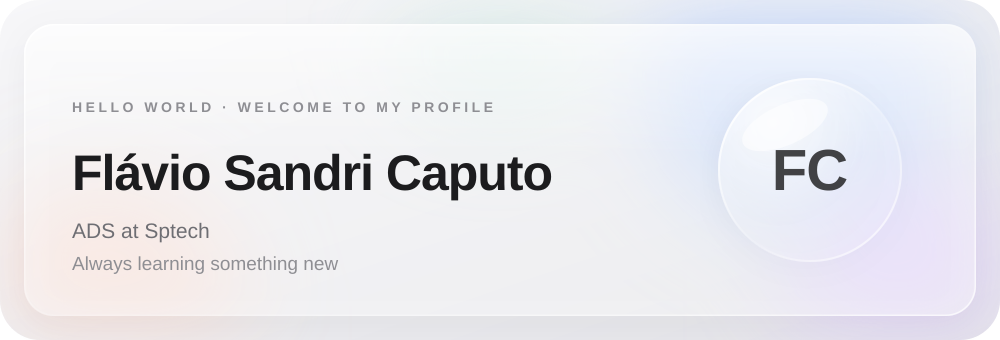
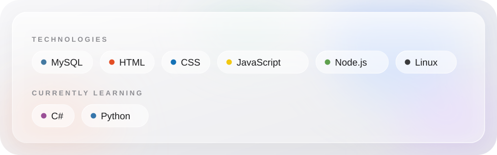

 

### About me

- Studying **Systems Analysis and Development (ADS)** at **Sptech**
- New profile here, but eager to build and learn

 

 

### Stats

<table align="center">
  <tr>
    <td width="50%" align="center">
      
    </td>
  </tr>
</table>

 

[GitHub](https://github.com/FlavioCaputo85) &nbsp;·&nbsp; [LinkedIn](https://br.linkedin.com/in/flaviocaputo)

